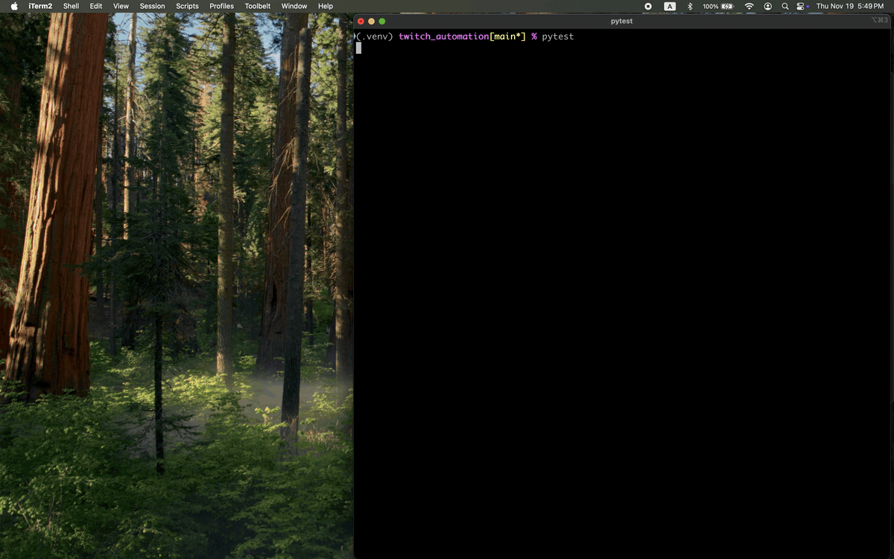

# Twitch WAP Automation

UI test framework for the Twitch mobile web site (**m.twitch.tv**), built with
**Python + Selenium 4 + pytest**, running on **Google Chrome's mobile emulator**.



---

## Scenario

| # | Step | Where it lives |
|---|------|----------------|
| 1 | Go to Twitch | `home_page` fixture → `HomePage.open()` |
| 2 | Click the search icon | `HomePage.open_search()` |
| 3 | Input "StarCraft II" | `BrowsePage.search()` |
| 4 | Scroll down 2 times | `SearchResultsPage.scroll_down(times=2)` |
| 5 | Select one streamer | `SearchResultsPage.select_streamer()` |
| 6 | Wait until everything is loaded, take a screenshot | `StreamerPage.wait_until_loaded()` + `screenshot` fixture |

Pop-ups that can block the flow ("Open in App" bottom sheet, mature-content
gate, cookie banner) are handled automatically on every page.

## Quick start

Requirements: Python 3.10+ and Google Chrome. ChromeDriver is resolved
automatically by Selenium Manager.

```bash
git clone https://github.com/themasteryyw/twitch_automation.git
cd twitch_automation
python3 -m venv .venv && source .venv/bin/activate
pip install -r requirements.txt

pytest                                   # run everything
pytest -m p0                             # critical path only
pytest --device "iPhone 14 Pro"          # another emulated device
pytest --headless                        # CI mode
pytest -n 2                              # parallel (pytest-xdist)
```

### Configuration

Every value resolves as **CLI option > environment variable > default**
(`config/settings.py`).

| Setting | CLI | Env var | Default |
|---|---|---|---|
| Site under test | `--base-url` | `TWITCH_BASE_URL` | `https://m.twitch.tv/` |
| Emulated device | `--device` | `DEVICE` | `Pixel 7` |
| Headless | `--headless` | `HEADLESS` | `false` |
| Explicit-wait timeout (s) | `--timeout` | `TIMEOUT` | `15` |
| Video start timeout (s) | – | `VIDEO_TIMEOUT` | `45` |
| Search term | – | `SEARCH_TERM` | `StarCraft II` |
| Scroll count | – | `SCROLL_TIMES` | `2` |

A single test can pin a device with `@pytest.mark.device("Galaxy S20")`.

### Artifacts

Written to `artifacts/` (git-ignored):

- `screenshots/` – step screenshots and `FAILED_*` screenshots
- `logs/run_<timestamp>_<worker>.log` – full DEBUG log per run
- `report.html` – self-contained pytest-html report; failures (in fixture
  setup or in the test body) embed the screenshot, URL and the last 20 browser
  console entries, and the exception is written to the run log

## Project structure

```
twitch_automation/
├── config/
│   ├── settings.py        # immutable Settings: CLI > env > default
│   └── devices.py         # device registry for Chrome mobileEmulation
├── framework/             # site-agnostic core, reusable for any web app
│   ├── driver_factory.py  # Chrome + mobile emulation, eager load, muted autoplay
│   ├── base_page.py       # BasePage: "loaded" contract, element helpers, go_to()
│   ├── waits.py           # Waiter + named JS conditions (no sleeps)
│   ├── popup_handler.py   # data-driven pop-up table + handler
│   ├── screenshot.py      # named, timestamped, xdist-safe screenshots
│   └── logger.py          # per-run log file + console
├── pages/
│   └── twitch/            # Twitch page objects (locators + actions only)
│       ├── twitch_base_page.py   # registers Twitch pop-ups
│       ├── home_page.py
│       ├── browse_page.py
│       ├── search_results_page.py
│       └── streamer_page.py
├── tests/
│   ├── conftest.py        # fixtures: driver -> pages, screenshot factory
│   └── test_search_streamer.py
├── conftest.py            # CLI options, settings, logging, failure artifacts
├── pytest.ini
└── requirements.txt
```

## Design decisions

- **Layered.** `framework/` knows nothing about Twitch; `pages/twitch/` knows
  nothing about pytest; tests read like the scenario and contain no locators.
- **Every page defines "loaded".** `BasePage.wait_until_loaded()` waits for
  `document.readyState`, clears pop-ups, then waits for the page's
  `ready_locator`. Navigation goes through `go_to()`, so a page object is
  always returned in a verified state.
- **"Streamer page fully loaded" is explicit:** channel URL → player mounted →
  `<video>` has data, is not paused and `currentTime > 0` → on-screen images
  decoded. Checking `readyState` alone passes while a stream is still buffering.
- **No `time.sleep`, no implicit waits.** All waits poll named conditions, so a
  timeout says exactly what never happened. Scrolling waits for the scroll
  position to settle instead of sleeping.
- **Pop-ups are data.** Each `Popup(name, detect, dismiss)` is one entry in a
  table. The handler runs on every page load *and on every poll of the video
  wait*, catching gates that appear after the player mounts. A visible but
  unregistered `aria-modal` is logged so new pop-ups get noticed.
- **Act only on unobstructed elements.** `click()` / `type_text()` wait until
  the element itself is the hit target at its centre (`elementFromPoint`),
  dismissing pop-ups on every poll. On this SPA the "Open in App" sheet renders
  ~0.6 s *after* the client-side navigation to `/directory`, i.e. after the page
  already counts as loaded; `element_to_be_clickable` alone does not detect the overlay.
- **Deterministic streamer choice.** The first visible live card in the
  StarCraft II category is preferred over a random pick, so failures reproduce.
- **Page-load strategy `eager`** because live previews keep the `load` event
  from firing reliably (observed in headless runs: `readyState` stayed below
  `complete` for 15 s on a fully rendered home page). Pages therefore treat
  `interactive` as DOM-ready and rely on their `ready_locator`.
- **Navigation clicks are verified.** `click_to_navigate()` waits for the URL
  to change and re-clicks once (with a WARNING) if the first click was lost;
  observed once in headless mode, where a click on "Browse" left the URL at `/`.

## Observations on the live site

Verified on m.twitch.tv (Pixel 7 emulation) on 2026-11-18:

- **Search icon.** The current mobile home page has no search icon in the top
  bar; the magnifier icon lives in the bottom navigation ("Browse"), which
  opens `/directory` with the search box. Step 2 clicks that icon.
- **Scroll down 2 times.** On the default "Top" results tab the page is only
  slightly taller than the viewport (e.g. 1194 px vs 919 px), so the first
  scroll already reaches the bottom. Both scrolls are still performed as the
  scenario requires; `scroll_down()` logs the before/after position and a
  WARNING when a scroll cannot move, so this is visible in the run log.

## Extending

- **New page:** subclass `TwitchBasePage`, declare locators (`btn_`, `input_`,
  `lbl_` prefixes) and a `ready_locator`, return it from the previous page via
  `go_to(NewPage)`.
- **New pop-up:** add a `Popup(...)` entry to `TWITCH_POPUPS`.
- **New device:** add a `DeviceProfile` to `config/devices.py`.
- **New site:** add `pages/<site>/` with its own base page; `framework/` is reused as is.
- **Prioritise runs:** tag tests `@pytest.mark.p0` / `p1` and select with `-m`.
